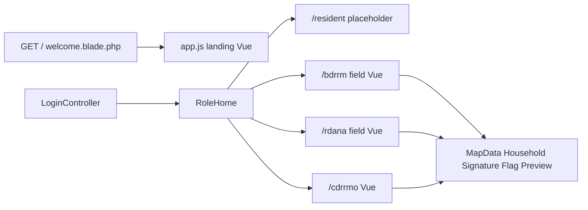

# Workspace module split

Investigation only. No files move until this plan is accepted. The recommendations below were checked against the current tree, not taken from the earlier draft.

## Verified architecture

- PHP 8.5.12. [composer.json](composer.json) requires `php: ^8.2` and `laravel/framework: ^12.0`. [composer.lock](composer.lock) pins Laravel **v12.70.2**.
- Vue **3.5** and Vue Router **5** are real app dependencies in [package.json](package.json). Vite 7, Tailwind 4, and `laravel-vite-plugin` are dev dependencies. There is no Inertia, Pinia, Breeze, Fortify, or Sanctum.
- Routing is session web routes only. [bootstrap/app.php](bootstrap/app.php) loads [routes/web.php](routes/web.php) and registers `/up`. There is no `routes/api.php`.
- Auth is the custom [app/Http/Controllers/Auth/LoginController.php](app/Http/Controllers/Auth/LoginController.php): email/password, rate limit, active-account check, then `RoleHome::redirectPath()`. Logout returns to the named `home` route. Guests hitting `auth` routes go to `login`. Signed-in users hitting `guest` routes go to `RoleHome::home()`.
- Confirmed role contracts in [app/Support/RoleHome.php](app/Support/RoleHome.php) and [database/seeders/RoleSeeder.php](database/seeders/RoleSeeder.php):

  - Resident: `resident`, `/resident`
  - BDRRM: `bdrrm`, `/bdrrm`
  - Assessor: `rdana`, `/rdana`
  - CDRRMO: `cdrrmo_admin`, `/cdrrmo`

- Vite entries in [vite.config.js](vite.config.js): `resources/css/app.css`, `resources/js/app.js`, `cdrrmo.js`, `rdana.js`, `bdrrm.js`.
- Every HTML page extends [resources/views/layouts/mapr.blade.php](resources/views/layouts/mapr.blade.php), which always loads `app.css`. Workspace pages then load a second sheet from JS.



## Module ownership

**Landing.** Public `GET /` is a closure in [routes/web.php](routes/web.php) (lines 36–42) returning [resources/views/welcome.blade.php](resources/views/welcome.blade.php). That Blade shell mounts Vue on `#app` via [resources/js/app.js](resources/js/app.js) and [resources/js/components/App.vue](resources/js/components/App.vue). Sections live in [resources/js/components/landing/](resources/js/components/landing/): header, hero carousel, about, features, workflow, responsible note, closing, footer. Sign-in uses `route('login')`. A signed-in visitor gets `dashboardUrl` from `RoleHome::home()` and the header/hero/closing/footer switch to that link. Assets stay at `/images/mapr-logo.png`, `hero-1.webp`, `hero-2.webp`, `hero-3.webp`. The page is already a Vue app. Do not convert it to Blade sections, and do not add a second Vue app.

**Auth.** [resources/views/auth/login.blade.php](resources/views/auth/login.blade.php) is Blade, styled by `.login-*` rules in [resources/css/app.css](resources/css/app.css) from line 137. It stays an auth concern, not a workspace page.

**Resident.** Two routes under `role:resident`: `WorkspaceController` renders [resources/views/workspace/show.blade.php](resources/views/workspace/show.blade.php) (“This workspace is not built yet”), plus `ImportedDocumentController@download`. No resident Vue app. Do not create one.

**BDRRM and Assessor.** Both are one Vue application. [resources/js/bdrrm.js](resources/js/bdrrm.js) and [resources/js/rdana.js](resources/js/rdana.js) call `mountFieldApp()` in [resources/js/field/mountField.js](resources/js/field/mountField.js). [app/Http/Controllers/Field/PageController.php](app/Http/Controllers/Field/PageController.php) chooses `bdrrm.app` or `rdana.app`. Middleware `field.scope` runs [app/Services/AssignmentScope.php](app/Services/AssignmentScope.php) for `bdrrm` and `rdana` only. CDRRMO is not barangay-scoped.

**CDRRMO.** Own router in [resources/js/cdrrmo.js](resources/js/cdrrmo.js) and shell [resources/views/cdrrmo/app.blade.php](resources/views/cdrrmo/app.blade.php). Catch-all is `WorkspacePageController`.

**Shared on purpose.** Leave these shared. Role controllers call them. Do not fork them.

- Models stay in [app/Models/](app/Models/). Eleven Eloquent models exist (`User`, `Role`, `Barangay`, `Building`, `Household`, `Resident`, and a few related rows). Reports, incidents, photos, signatures, and assessments are `DB::table()` queries. Role-specific model folders do not match this data. One `residents` table is read by CDRRMO and Assessor.
- Services: `ReportWorkflow`, `ImpactEstimator`, `AreaSummaryService`, `AssignmentScope`, plus `SignatureConfirmation`, `ActivityLogger`, `BuildingLocationReviewService`, `MapSelectionPreviewService`, `PolygonSpatial`.
- Policies in [app/Policies/](app/Policies/) are called directly (`abort_unless($policy->view(...))`). They are not registered on the Gate. Leave that call style alone during the move.
- `EnsureRole` and `RoleHome`.

Allowed dependency direction: role module to `Shared`, `Services`, `Models`, `Policies`, `Support`. `Shared` must not import a role controller or a role page. One role must not import another role’s page or controller.

## Coupling findings

- **One field app for two roles.** [resources/js/field/mountField.js](resources/js/field/mountField.js) lines 15–55 switch route tables, history base, and `apiBase` on `role === 'bdrrm'`. The same `fieldRole` checks are in `FieldSidebar.vue`, `field/App.vue`, `DashboardPage.vue`, `MapPage.vue`, `QueuePage.vue`, `ReportPage.vue`, and `ReportWorkspace.vue`. Affected: BDRRM and Assessor. A sidebar or report edit changes both. Split into `resources/js/bdrrm/` and `resources/js/assessor/` and delete the branches.

- **Assessor residents page is the CDRRMO page.** `mountField.js` line 9 imports [resources/js/cdrrmo/pages/ResidentsPage.vue](resources/js/cdrrmo/pages/ResidentsPage.vue). `canMutateResidents` defaults to true and is set false only in the Assessor/BDRRM mount (line 69). Affected: Assessor and CDRRMO. Copy the page into the Assessor tree and remove the flag from the CDRRMO page. Write routes stay on `role:cdrrmo_admin` only. The flag is not authorization.

- **Assessor residents page calls a CDRRMO-only endpoint.** `ResidentsPage.vue` line 136 requests `${apiBase}/area-context`. That route exists only under `/cdrrmo` ([routes/web.php](routes/web.php) lines 191–192). On `/rdana` the call fails and the `catch` clears context. Affected: Assessor. The Assessor copy should omit that call. CDRRMO keeps it. This preserves the current Assessor result.

- **Map components sit inside CDRRMO.** `MapWorkspace.vue` and `MapIcon.vue` are imported by CDRRMO and by field dashboard, map, sidebar, queue, and report workspace. Affected: Landing is not involved. BDRRM, Assessor, and CDRRMO are. Move both to `resources/js/shared/components/` and keep the `apiBase` prop.

- **CDRRMO also imports field components.** [resources/js/cdrrmo/pages/ProfilePage.vue](resources/js/cdrrmo/pages/ProfilePage.vue) line 3 imports `field/components/SignatureCard.vue`. [resources/js/cdrrmo/pages/ReportListPage.vue](resources/js/cdrrmo/pages/ReportListPage.vue) line 5 imports `field/components/ReviewSignDialog.vue`. Affected: CDRRMO, BDRRM, Assessor. Move those two components to `shared` as well. A one-way “field is shared, CDRRMO is private” split would still leave CDRRMO depending on BDRRM/Assessor files.

- **CDRRMO controllers are mounted on other prefixes.** In [routes/web.php](routes/web.php), `Cdrrmo\MapDataController` and `Cdrrmo\HouseholdController` are registered on `/bdrrm`, `/rdana`, and `/cdrrmo`. `Cdrrmo\ResidentController` (978 lines) is read-mounted on `/rdana` and read/write on `/cdrrmo`. `Cdrrmo\BuildingLocationCorrectionController` `propose` is on both `/rdana` and `/cdrrmo`; `apply` is CDRRMO-only. Affected: all three authenticated map workspaces. Move map, household, and `propose` to `App\Http\Controllers\Shared`. Give Assessor its own read resident controller. Keep writes on `Cdrrmo\ResidentController`.

- **Shared field controllers.** `Field\ContextController` (635 lines) serves both dashboards. `PreviewController` serves barangay previews for all three roles, assessment previews for Assessor and CDRRMO, and consolidated previews for CDRRMO. `PhotoController` is used by BDRRM writes and by Assessor/CDRRMO reads. Root `SignatureAssetController`, `ReportFlagController`, and `ImportedDocumentController` are multi-role. Move them to `Shared`. `BdrrmReportController` and `RdanaAssessmentController` are already single-role and should leave `Field`.

- **One route file and catch-alls.** [routes/web.php](routes/web.php) mixes landing, login, logout, and all four workspaces. Each workspace catch-all is `/{any?}` and is already last inside its prefix group (BDRRM line 96, Assessor line 145, CDRRMO line 211). Splitting files is safe only if each role file still registers API routes before its catch-all, and [routes/web.php](routes/web.php) loads landing, then auth, then resident, bdrrm, assessor, cdrrmo.

- **Global CSS.** [resources/views/layouts/mapr.blade.php](resources/views/layouts/mapr.blade.php) line 12 loads [resources/css/app.css](resources/css/app.css) for the landing page, login, resident placeholder, and all dashboards. That file holds Tailwind, theme tokens, `.mapr-button`, login rules, resident `.workspace-*` rules, and older `.admin-*` / `.map-toolbar` rules. `MapWorkspace.vue` still uses `map-toolbar` (around line 710). [resources/css/cdrrmo-admin.css](resources/css/cdrrmo-admin.css) is imported by `cdrrmo.js` and `mountField.js`, not by the landing entry. Landing section styles are mostly `scoped` in the landing Vue files, so a CDRRMO sheet change does not restyle the landing page. A change to `app.css` base, tokens, or `.mapr-button` does. Do not invent empty per-role CSS trees. Move sheets without rewriting selectors.

- **Session key shared across roles.** `ResidentController::storeMapFocus` writes session key `cdrrmo.resident_map_focus` (line 393) and Assessor uses the same methods. Keep that key when the read controller is split.

- **Unreferenced page.** [resources/js/cdrrmo/pages/AssessmentMapPage.vue](resources/js/cdrrmo/pages/AssessmentMapPage.vue) has no importer. The live map route uses `MapWorkspace`. Do not delete it until phase 8 confirms no references.

Modularization does not isolate `ReportWorkflow` or `AssignmentScope`. A change there still needs BDRRM, Assessor, and CDRRMO regression checks.

## Target structure

Keep Vite entry filenames so Blade `@vite` directives and the manifest stay stable: `app.js`, `bdrrm.js`, `rdana.js`, `cdrrmo.js`. Those files become thin bootstraps that import the new folders. Keep DOM ids `app`, `bdrrm-app`, `rdana-app`, `cdrrmo-app`.

```text
app/Http/Controllers/
  Landing/HomeController.php
  Auth/LoginController.php
  Resident/WorkspaceController.php
  Bdrrm/PageController.php
  Bdrrm/BarangayReportController.php
  Assessor/PageController.php
  Assessor/AssessmentController.php
  Assessor/ResidentController.php
  Cdrrmo/                         admin-only controllers, including resident writes
  Shared/                        map, household, photo, preview, signature, flag, documents, location propose

resources/views/
  layouts/mapr.blade.php         unchanged shell
  landing/home.blade.php
  auth/login.blade.php
  resident/show.blade.php
  bdrrm/app.blade.php
  assessor/app.blade.php         still mounts #rdana-app and rdana.js
  cdrrmo/app.blade.php
  shared/                        field preview blades if PreviewController moves with them

resources/js/
  app.js                         bootstrap only
  bdrrm.js
  rdana.js
  cdrrmo.js
  landing/                       current components/landing plus App.vue
  bdrrm/
  assessor/
  cdrrmo/
  shared/components/             MapWorkspace, MapIcon, SignatureCard, ReviewSignDialog

resources/css/
  app.css                        tokens, base, .mapr-button, map-toolbar still used by the map
  auth.css                       login rules moved out of app.css, imported by the layout only on the login view or kept imported from app.css in the same phase as the visual check
  resident.css                   .workspace-* rules
  shared/workspace.css           current cdrrmo-admin.css, renamed without selector edits

routes/
  web.php                        requires the others, in order
  landing.php
  resident.php
  bdrrm.php
  assessor.php
  cdrrmo.php
```

Do not add `app/Models/Resident` or other role model folders. Do not add empty `resources/css/bdrrm` or `resources/js/resident` directories. Do not add resident features.

`Landing\HomeController` is a single invokable that returns the existing view data (`dashboardUrl`). It replaces the closure so the landing route has an owner. It does not change the response.

Assessor folder names do not rename `rdana` in the database, URLs, route names (`rdana.dashboard`), or the `#rdana-app` id.

## Migration matrix

Each row is current path, then proposed path, then what must be updated, then risk.

- [routes/web.php](routes/web.php) closure for `GET /` to [routes/landing.php](routes/landing.php) plus `Landing\HomeController`. Update the route name `home` so it stays on that route. Low risk if the name and view data stay.
- [resources/views/welcome.blade.php](resources/views/welcome.blade.php) to `resources/views/landing/home.blade.php`. Update the controller return. Low. Keep `#app`, `data-sign-in-url`, `data-dashboard-url`, preload of `/images/hero-1.webp`, and `@vite(['resources/js/app.js'])`.
- [resources/js/components/App.vue](resources/js/components/App.vue) and [resources/js/components/landing/](resources/js/components/landing/) to `resources/js/landing/`. Update `app.js` imports. Low. Asset URLs stay `/images/...`.
- [app/Http/Controllers/WorkspaceController.php](app/Http/Controllers/WorkspaceController.php) to `Resident\WorkspaceController`. [resources/views/workspace/show.blade.php](resources/views/workspace/show.blade.php) to `resources/views/resident/show.blade.php`. Update resident routes. Low. Placeholder copy stays.
- [app/Http/Controllers/Field/BdrrmReportController.php](app/Http/Controllers/Field/BdrrmReportController.php) to `Bdrrm\BarangayReportController`. Update `/bdrrm` routes only. Medium because of policy constructor injection. Behavior stays.
- [app/Http/Controllers/Field/RdanaAssessmentController.php](app/Http/Controllers/Field/RdanaAssessmentController.php) to `Assessor\AssessmentController`. Update `/rdana` routes only. Medium, same reason.
- [app/Http/Controllers/Field/PageController.php](app/Http/Controllers/Field/PageController.php) to `Bdrrm\PageController` and `Assessor\PageController`. Each returns its own view. Update catch-all routes. Low.
- `Cdrrmo\MapDataController`, `Cdrrmo\HouseholdController`, `SignatureAssetController`, `ReportFlagController`, `ImportedDocumentController`, `Field\PreviewController`, `Field\PhotoController` to `Shared` with the same class names. Update every prefix that registers them. Medium. URLs stay. `PreviewController` view names `field.*` move with the blades to `shared.*` in the same step.
- `Cdrrmo\BuildingLocationCorrectionController::propose` to `Shared`. `apply` stays on a CDRRMO controller. Medium. Keep both URLs.
- `Cdrrmo\ResidentController` stays for CDRRMO writes. New `Assessor\ResidentController` gets `summary`, `index`, `show`, `reports`, `showMapFocus`, `storeMapFocus` only. Extract duplicated query methods into something like `app/Services/ResidentRegistryQuery.php` when both controllers would copy them. Do not change SQL, scope filters, or the session key. High, because this is the largest controller. Assessor routes must not register `store`, `update`, `archive`, `restore`, `addInclusions`, or `removeInclusions`.
- `resources/js/field/**` copied to `resources/js/bdrrm/**` and `resources/js/assessor/**`, then role branches removed, then `resources/js/field/` deleted. Update `bdrrm.js` and `rdana.js`. High. Vue route paths inside each app stay (`/`, `/map`, `/reports/...`).
- `MapWorkspace.vue`, `MapIcon.vue`, `SignatureCard.vue`, `ReviewSignDialog.vue` to `resources/js/shared/components/`. Update CDRRMO, BDRRM, and Assessor imports. Medium.
- `cdrrmo-admin.css` to `resources/css/shared/workspace.css`. Update the two JS imports. Low if selectors are not edited. Class names may still say `cdrrmo-`.
- Login and `.workspace-*` blocks move out of `app.css` only after a side-by-side check that landing, login, and the resident placeholder look the same. Medium visual risk. Leave `.map-toolbar` and tokens in `app.css`.

CDRRMO-only controllers stay in `Cdrrmo`: dashboard, workspace page, workspace dashboard, nav badges, activity, incidents, report index, users, area context, estimates, map selection, report context, report preview context, consolidated signature, building verify-bulk.

## Phased implementation

1. **Baseline.** Record `php artisan route:list`, `php artisan test`, and `npm run build`. Note failures that already exist. Do not edit tests to match the move.
2. **Landing.** Add `routes/landing.php` and `Landing\HomeController`. Move the Blade shell and Vue landing files. `web.php` requires landing first. Check `/`, sign-in link, signed-in dashboard link, hero images, and carousel. No workspace file should import `resources/js/landing`.
3. **Role routes and single-owner controllers.** Add the four route files. Move `BarangayReportController`, `AssessmentController`, both page controllers, and the resident workspace. Require files from `web.php` in this order: landing, auth routes still in `web.php`, resident, bdrrm, assessor, cdrrmo. Inside bdrrm, assessor, and cdrrmo, the `/{any?}` catch-all stays last. Run `route:list` and compare method, URI, middleware, and name to the baseline.
4. **Shared controllers and resident read split.** Move the shared controllers. Split Assessor resident reads from CDRRMO writes. Preserve JSON keys and the map-focus session key. Confirm an Assessor session cannot call `/rdana/api/residents` POST or archive.
5. **BDRRM and Assessor frontends.** Copy the field app, drop `fieldRole` branches, point each entry at its tree, move shared components, delete `resources/js/field` only after `rg` shows no imports. Assessor residents page is its own file and does not request `/area-context`.
6. **Resident and CDRRMO file homes.** Resident stays the placeholder. CDRRMO pages stay in `resources/js/cdrrmo` and import shared components instead of `field/`. No new screens.
7. **CSS.** Rename `cdrrmo-admin.css` to `resources/css/shared/workspace.css` without selector edits. Move login and resident placeholder rules only if the landing page and login page still match the baseline. Do not create empty role CSS folders.
8. **Cleanup.** Delete `Field` controllers, `mountField.js`, and `AssessmentMapPage.vue` only when a repository search shows no references. Leave models, services, policies, and schema untouched.

Rollback for any phase is reverting that phase’s file moves. Do not mix phase 4 and phase 5 in one review if the diff becomes unreadable. URLs stay stable, so feature tests should not need assertion edits unless a response actually changes.

## Acceptance checklist

- `GET /` still renders the same landing content, carousel, responsive layout, `/images/*` URLs, Sign in link, and signed-in workspace link.
- Login, logout, inactive account, and unknown role still behave as in `LoginController`. Each role still lands on its current prefix.
- `resident` cannot open `/bdrrm`, `/rdana`, or `/cdrrmo`. `bdrrm` and `rdana` still get 403 outside assigned barangays. `cdrrmo_admin` stays city-wide.
- Assessor resident API is read-only. CDRRMO resident writes still work. `canMutateResidents` is gone. Authorization remains the route middleware plus existing policy checks.
- Route list matches the baseline for method, URI, and name. Catch-alls remain last in each prefix.
- `rg` finds no `App\Http\Controllers\Field\`, no `mountField`, no `fieldRole`, and no import of `cdrrmo/pages/ResidentsPage` from Assessor or BDRRM.
- BDRRM and Assessor Vue files do not import `resources/js/cdrrmo/pages` or `resources/js/cdrrmo/components`. CDRRMO does not import `resources/js/bdrrm` or `resources/js/assessor`.
- `php artisan test` and `npm run build` match the baseline, plus any new failures are treated as regressions. Existing failures stay listed separately and are not “fixed” by weakening assertions.
- Report create, sign, submit, assessor verify/approve, flags, signature image, and document download still hit the same URLs.

## Separate from this refactor

These are existing behaviors to preserve or ticket, not to redesign here.

- UI hiding of resident edits is not the security boundary. The route group is.
- Assessor and CDRRMO share the session key `cdrrmo.resident_map_focus`.
- Policies are manual method calls, not Gate policies.
- `resources/js/cdrrmo/pages/AssessmentMapPage.vue` looks unused while `MapWorkspace` is the live map.
- `docs/MAPR_IMPLEMENTATION_PLAN.md` describes an older repository state and is not the source of truth for this move.
