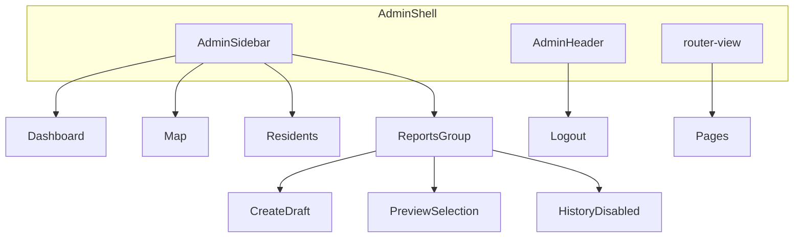

# CDRRMO UI and geographic location verification — implementation plan

**Planning deliverable:** After approval, persist this document verbatim to [`docs/CDRRMO_UI_AND_LOCATION_VERIFICATION_PLAN.md`](docs/CDRRMO_UI_AND_LOCATION_VERIFICATION_PLAN.md). No application code, seeders, credentials, or database mutations during planning.

---

## 1. Repository findings and confirmed assumptions

### Login (matches screenshots)

- [`resources/views/auth/login.blade.php`](resources/views/auth/login.blade.php): split layout — hidden-on-mobile `.login-brand` + `.login-panel`; desktop (`min-width: 960px` in [`resources/css/app.css`](resources/css/app.css)) shows blue `.login-brand` with copy and `hero-1.webp`.
- Password toggle: external text button in `.password-row` (lines 68–70), not an in-field icon.
- Logo: login uses `/images/mapr-logo.png` (display copy per [`docs/MAPR_VISUAL_ASSETS.md`](docs/MAPR_VISUAL_ASSETS.md)); source is [`assets/MapR_Logo.png`](assets/MapR_Logo.png). Requirement: center logo **inside the card** using the same display asset (do not rewrite source PNG).

### CDRRMO admin (matches screenshot)

- Shell: [`resources/js/cdrrmo/App.vue`](resources/js/cdrrmo/App.vue) — three flat nav links, minimal header (`userName · userEmail`), secondary logout.
- Styles: shared [`resources/css/app.css`](resources/css/app.css) (`.admin-shell`, `.admin-side`, `.admin-stats`, etc.) — functional but not a modern SaaS layout.
- Router: [`resources/js/cdrrmo.js`](resources/js/cdrrmo.js) — routes `/`, `/map`, `/residents` only.

### Map and estimates (partially implemented)

- [`resources/js/cdrrmo/pages/AssessmentMapPage.vue`](resources/js/cdrrmo/pages/AssessmentMapPage.vue): Mapbox Draw polygon, `POST /cdrrmo/api/estimates/preview`, draft report via **GET** `reportUrl()` with encoded coordinates in query string.
- Building GeoJSON already exposes `status` ([`MapDataController::buildings`](app/Http/Controllers/Cdrrmo/MapDataController.php)); paint is not yet status-differentiated.
- **No** selection preview or verify/reject endpoints.

### Dashboard totals (data-quality note — not a query bug)

Screenshot shows **5951 / 5951 / 5951** because [`ImportGeospatialCommand::importHouseholds`](app/Console/Commands/ImportGeospatialCommand.php) creates **one transaction per CBMS point**:

1. One `buildings` row (`CBMS22-BLDG-{ID}`)
2. One `households` row (`CBMS22-HH-{ID}`)
3. One `residents` row **only when** `A1FNAME01` and `A1LNAME01` are both nonempty

Equal totals in dev mean every imported point had person-01 names; this is **not** proof that buildings, households, and residents are independently counted domains. UI should label cards clearly (e.g. “Registry buildings (CBMS geotags)”) and keep dashboard notes from [`DashboardController`](app/Http/Controllers/Cdrrmo/DashboardController.php). Do not fabricate charts or trends.

[`DashboardController`](app/Http/Controllers/Cdrrmo/DashboardController.php) uses independent `COUNT(*)` on three tables — correct for current schema; divergence will appear if future imports add buildings without residents.

### Spatial logic to reuse

- [`ImpactEstimator`](app/Services/ImpactEstimator.php): `polygonWkt()`, Philippines bbox guard, `ST_Intersects` vs `ST_Within` with `axis-order=long-lat`.
- Official counts filter `location_verification_status = 'verified'`; review selection must **not** apply that filter by default.

### Audit / schema for verification

- [`buildings`](database/migrations/2026_10_28_000005_create_buildings_table.php): statuses `unverified|verified|rejected`; **verified** CHECK requires `geographic_point`, `location_source`, `location_verified_by`, `location_verified_at`. **Rejected** has no symmetric CHECK — do not overload `location_verified_by` as “rejected by” without documentation.
- [`building_verifications`](database/migrations/2026_10_28_000022_create_building_verifications_table.php): tied to `field_assessments`, damage classes, and RDANA workflow — **not** suitable for CDRRMO desktop location review without inventing field assessments.
- **Conclusion:** add a minimal **`building_location_reviews`** audit table (see §6) rather than reusing `building_verifications`.

### Reports

- Only [`ReportController::preview`](app/Http/Controllers/Cdrrmo/ReportController.php) exists; **no** consolidated report list API. Reports submenu item **Report history** → disabled “Coming soon” (no fake list).

### Demo account

- [`MaprDemoUserSeeder`](database/seeders/MaprDemoUserSeeder.php): `lester.talan.demo@mapr.test`, password from `config('mapr.demo_password')` / `MAPR_DEMO_PASSWORD`; skip-if-exists (no email/password updates on rerun).
- Login validation: [`LoginController`](app/Http/Controllers/Auth/LoginController.php) uses `'email' => ['required', 'email']`.

### Email validator blocker (must resolve in implementation)

Requested local login id: `lestertalan@mapr_admin.com` — underscore in the **domain label** (`mapr_admin`) is invalid for DNS and is **often rejected** by Laravel’s default `email` rule (RFC/DNS validation).

**Decision path (pick one during implementation, document in plan doc §10):**

- **A (preferred if validation passes):** Keep address; add feature test proving login form + `LoginController` accept it.
- **B:** If validation fails, use `Rule::when` / custom demo-only normalization **only in seeder + login lookup** without disabling global email validation — **or** ask product owner for an RFC-valid local domain (e.g. `lestertalan@mapr-admin.test`) while storing display alias separately.

Do **not** silently rename in seeder without documenting.

---

## 2. Files to create or change

| Area | Files |
|------|--------|
| Login | [`resources/views/auth/login.blade.php`](resources/views/auth/login.blade.php), [`resources/css/app.css`](resources/css/app.css) (login block only) |
| Admin CSS | **New** [`resources/css/cdrrmo-admin.css`](resources/css/cdrrmo-admin.css), import from [`resources/js/cdrrmo.js`](resources/js/cdrrmo.js) |
| Shell / nav | [`resources/js/cdrrmo/App.vue`](resources/js/cdrrmo/App.vue), **new** `resources/js/cdrrmo/components/AdminSidebar.vue`, `AdminHeader.vue`, `ReportsNavGroup.vue` |
| Pages | [`DashboardPage.vue`](resources/js/cdrrmo/pages/DashboardPage.vue), [`ResidentsPage.vue`](resources/js/cdrrmo/pages/ResidentsPage.vue), [`AssessmentMapPage.vue`](resources/js/cdrrmo/pages/AssessmentMapPage.vue) |
| Router / state | [`resources/js/cdrrmo.js`](resources/js/cdrrmo.js), optional **new** `resources/js/cdrrmo/composables/useMapSelection.js` |
| Backend routes | [`routes/web.php`](routes/web.php) |
| Controllers | **New** `app/Http/Controllers/Cdrrmo/MapSelectionController.php`, `BuildingLocationController.php`; extend [`MapDataController`](app/Http/Controllers/Cdrrmo/MapDataController.php) (`location_source` on building detail) |
| Services | **New** `app/Services/PolygonSpatial.php` (extract WKT/validation from `ImpactEstimator`), **new** `app/Services/BuildingLocationReviewService.php` |
| Models | **New** `app/Models/BuildingLocationReview.php`; extend [`Building`](app/Models/Building.php) if needed |
| Migration | **New** `database/migrations/2026_10_29_000006_create_building_location_reviews_table.php` (name/date as next available) |
| Reports session | [`ReportController`](app/Http/Controllers/Cdrrmo/ReportController.php), optional `POST cdrrmo/api/reports/context` |
| Seeder / tests | [`MaprDemoUserSeeder.php`](database/seeders/MaprDemoUserSeeder.php), [`DemoUserSeederTest.php`](tests/Feature/DemoUserSeederTest.php), **new** `tests/Feature/BuildingLocationReviewTest.php`, **new** `tests/Feature/LoginLayoutTest.php` (or extend [`CdrrmoWorkspaceTest`](tests/Feature/CdrrmoWorkspaceTest.php)) |
| Docs | [`docs/CDRRMO_UI_AND_LOCATION_VERIFICATION_PLAN.md`](docs/CDRRMO_UI_AND_LOCATION_VERIFICATION_PLAN.md) (this file), brief note in [`docs/MAPR_VISUAL_ASSETS.md`](docs/MAPR_VISUAL_ASSETS.md) for login logo placement |
| Env example | [`.env.example`](.env.example) — comment only for `MAPR_DEMO_PASSWORD` (no plaintext) |

**Do not change:** landing Vue, other role workspaces, geospatial import logic, `report_signatories.md` content, signed-report guards.

---

## 3. Component and route changes

### Login

- Remove `<aside class="login-brand">` and `.login-mobile-brand`; single `.login-shell` flex center on `#F8FAFC`.
- White card: `max-width: 28rem`, border `#E2E8F0`, shadow, radius `16–20px`, padding `24–32px`.
- Logo centered above `h1` — `/images/mapr-logo.png`, `height` ~4–5rem, `width: auto`, `object-fit: contain`.
- Replace `.password-row` button with `.password-field` wrapper: input `padding-right: 2.75rem`; icon button `position: absolute; right: 0.75rem`; inline SVG eye / eye-off; `type="button"`; min 44×44px touch target; update `@push('scripts')` toggle logic.
- Remove desktop media rules that re-enable split layout (lines 353–414 in `app.css`).

### CDRRMO shell



- **Desktop:** fixed sidebar (~16rem), scrollable main.
- **Mobile:** drawer overlay; `Escape` closes; focus trap on open; hamburger in header.
- **Header:** route meta title or computed page title; avatar initials from `userName`; email truncate with `title` tooltip; existing POST logout unchanged.
- **ReportsNavGroup:**
  1. *Create draft impact report* → `router.push({ path: '/map', query: { mode: 'estimate' } })` + toast/helper if no polygon.
  2. *Preview current selection* → enabled when composable/session has valid polygon + estimate context; opens preview via **POST form or session** (see §7), not long GET URLs.
  3. *Report history* → disabled “Coming soon”.

Optional route meta in `cdrrmo.js`:

```js
{ path: '/map', meta: { title: 'Assessment Map' } }
```

No new Vue route required for preview if using Blade `reports/preview` + session.

### Map modes

- Toolbar segmented control: **Estimate impact** | **Review locations**.
- Shared Mapbox Draw polygon; changing polygon, barangay filter, or mode clears: selected building IDs, preview pagination, selection token, estimate panel (mode-specific).
- **Estimate impact:** existing preview + draft report (updated to use session/context).
- **Review locations:** after draw → `POST .../selection/preview` → paginated panel with checkboxes, basis/reason field, confirm dialog, bulk submit.

### Dashboard / Residents polish

- **Dashboard:** human labels for stat keys; secondary line on totals; CTA row “Open map” + “Review unverified locations” (`/map?mode=review&verification=unverified`); keep honest notes list.
- **Residents:** sticky filter bar; add `rejected` filter option; row action “View on map”; surface `verification` from building; empty/loading/error unchanged pattern.

---

## 4. API request/response contracts

All routes: `middleware(['auth', 'role:cdrrmo_admin'])`, `prefix('cdrrmo')`, JSON POST with CSRF (axios already configured in `cdrrmo.js`).

### `POST /cdrrmo/api/map/selection/preview`

**Request (JSON):**

```json
{
  "geometry": {
    "type": "Polygon",
    "coordinates": [[[lng, lat], ...]]
  },
  "spatial_rule": "includes_boundary",
  "barangay_id": null,
  "status": "unverified",
  "page": 1,
  "per_page": 50
}
```

- `geometry`: only `Polygon`; single ring for MVP (exterior ring); reject MultiPolygon in v1 or document conversion.
- Validation: closed ring (first equals last), ≥4 positions, finite numbers, reuse [`ImpactEstimator::polygonWkt`](app/Services/ImpactEstimator.php) bbox; add `ST_IsValid` on constructed geometry; max vertices (e.g. 500) and max body size.
- `spatial_rule`: `includes_boundary` → `ST_Intersects`; `strict_interior` → `ST_Within`.
- Optional `barangay_id`: restrict to study barangays (existing four).
- Optional `status`: `unverified` \| `verified` \| `rejected` \| omit for all.

**Response:**

```json
{
  "selection_id": "uuid-or-hmac-token",
  "selection_fingerprint": "sha256(...)",
  "spatial_rule": "includes_boundary",
  "totals_by_status": { "unverified": 0, "verified": 0, "rejected": 0 },
  "linked_totals": { "households": 0, "residents": 0 },
  "unmapped_buildings_in_scope": 0,
  "buildings": {
    "data": [{
      "id": 1,
      "reference": "CBMS22-BLDG-1",
      "barangay": "Telaje",
      "location_status": "unverified",
      "location_source": "...",
      "household_count": 1,
      "resident_count": 1,
      "location_fingerprint": "hash(point+updated_at)"
    }],
    "current_page": 1,
    "last_page": 1,
    "total": 0
  },
  "criteria": { ... }
}
```

- Store `selection_id` + fingerprint + polygon WKT hash in **session** (server-side) for bulk verify binding; expire after TTL or logout.

### `POST /cdrrmo/api/buildings/verify-bulk`

**Request:**

```json
{
  "selection_id": "...",
  "building_ids": [1, 2, 3],
  "action": "verify",
  "basis": "Desktop review against CBMS geotag and barangay boundary.",
  "expected_fingerprints": { "1": "...", "2": "..." }
}
```

- `building_ids`: required, unique, max batch (e.g. 100).
- `action`: `verify` \| `reject`.
- `basis`: required for `verify` (min length e.g. 10).
- `reject` → require `reason` (map to `basis` field or separate key aliased to same column).

**Server checks (all-or-nothing transaction):**

1. `selection_id` matches session and polygon still valid.
2. Each building exists; `barangay_id` in authorized set.
3. Each building’s point satisfies polygon predicate under stored `spatial_rule`.
4. Each `location_fingerprint` matches current row (detect stale/concurrent moves).
5. **verify:** `geographic_point` and nonempty `location_source`; do not change coordinates.
6. **reject:** nonempty reason; do not set status to `verified`.

**Response:**

```json
{
  "changed": 3,
  "unchanged": 0,
  "results": [{ "id": 1, "status": "verified" }]
}
```

On any failure: **422** with per-id errors; **zero** rows updated.

### Optional `POST /cdrrmo/api/buildings/{building}/location-review`

Same service method with single ID; same validation.

### Map buildings layer

Extend GeoJSON properties: include `status` (already present). Add data-driven `circle-color` / `circle-stroke-color` in Vue for unverified / verified / rejected / selected.

### Building detail API

Add `location_source` to [`MapDataController::building`](app/Http/Controllers/Cdrrmo/MapDataController.php) JSON for review panel.

---

## 5. Verification state transitions and audit strategy

| From | To | Building columns | Audit row |
|------|-----|------------------|-----------|
| unverified | verified | `status=verified`, set `location_verified_by/at`, keep point/source | insert review |
| unverified | rejected | `status=rejected`, clear `location_verified_by/at` | insert review |
| rejected | verified | same as unverified→verified | insert review |
| verified | rejected | `status=rejected`, clear verified_by/at | insert review |

- **Idempotency:** if record already in target status with same basis hash optional skip; do **not** bump `location_verified_at` on no-op verify.
- **Audit table** `building_location_reviews`:
  - `id`, `building_id`, `previous_status`, `new_status`, `basis_or_reason` (TEXT), `reviewed_by` (FK users), `reviewed_at`, `selection_id` (nullable), `created_at`
  - Append-only; no updates/deletes in application code.
- **Wording in UI:** “Verify building location”, “Reject building location”, “Linked households/residents” — never “Verify residents”.
- **Scope disclaimer:** “Administrative review of geotag plausibility — not a substitute for RDANA field assessment unless linked field evidence exists.”

**Does not change:** resident identity fields, household links, damage predictions, report signatures, estimate snapshots already stored.

**Estimates after rejection:** [`ImpactEstimator`](app/Services/ImpactEstimator.php) official counts exclude non-verified; rejected points remain in source-registry counts when status filter is null.

---

## 6. Minimal additive migration

**`building_location_reviews`** (new table) as above.

Optional on `buildings` (only if needed for UI queries without joining audit):

- `location_reviewed_at` / `location_reviewed_by` as **last review** — **defer** unless queries require; prefer audit table + current status.

Do **not** alter `building_verifications` or field-assessment workflow.

---

## 7. Reports and selection context (avoid long URLs)

- **Problem:** [`AssessmentMapPage.vue`](resources/js/cdrrmo/pages/AssessmentMapPage.vue) `reportUrl()` puts coordinates in query string.
- **Plan:**
  - Add `POST /cdrrmo/api/reports/context` storing `{ coordinates, spatial_rule, generated_at }` in session; return `{ ok: true }`.
  - Change [`ReportController::preview`](app/Http/Controllers/Cdrrmo/ReportController.php) to read session context when query `coordinates` absent; keep GET for backward compat one release or redirect.
  - Reports submenu “Preview current selection” triggers context POST then `window.open('/cdrrmo/reports/preview')`.
- Dropdown helper text: polygon required; active incident only for snapshot persistence (existing `can_snapshot` note).

---

## 8. Lester demo account migration

Target email: `lestertalan@mapr_admin.com`. Password: **only** via `MAPR_DEMO_PASSWORD` in untracked `.env` (never in plan file, code, `.env.example` value, or tests — tests use `config(['mapr.demo_password' => '...'])`).

**Seeder logic** (local/testing only, DB transaction):

| Condition | Action |
|-----------|--------|
| Old exists, new absent | Verify old row is Lester (name + `cdrrmo_admin` role); update email; rehash password from config |
| New exists | If intended Lester demo, skip on rerun; **do not** auto-reset password |
| Neither | Create Lester with role code lookup |
| Both exist | Throw `RuntimeException` with clear message |

**Optional explicit reset:** `php artisan mapr:reset-lester-demo-password` (local only) — not default seeder behavior.

**Post-implementation operator steps** (document only):

1. Set `MAPR_DEMO_PASSWORD` in local `.env` (quote if special chars).
2. `php artisan config:clear`
3. `php artisan db:seed --class=MaprDemoUserSeeder`
4. Login → expect redirect to `/cdrrmo`.

Update [`DemoUserSeederTest.php`](tests/Feature/DemoUserSeederTest.php): migration path preserves user `id`; rerun idempotency; conflict case; email validation test.

---

## 9. Test plan and acceptance criteria

### Login / layout

- DOM: no `.login-brand`, no `hero-1.webp`; card centered; logo inside card.
- 375 / 768 / 1440: card margins, no horizontal scroll; password icon toggles type; Enter submits; Roboto on inputs (existing font stack).
- Feature: login still rate-limits and validates credentials.

### Authorization

- Guest → 401/redirect on new POST endpoints.
- resident/bdrrm/rdana → 403 on selection preview and verify-bulk.
- Bulk request with ID outside polygon → 422, no DB change.

### Geometry / selection

- Point inside / on boundary / outside for both spatial rules.
- Invalid ring, self-intersecting polygon (MySQL invalid), too many vertices → 422.
- Pagination + status filter; distinct household/resident counts with test fixtures (multi-resident household if schema allows in factory).

### Verification

- Happy path unverified → verified with basis.
- Missing `location_source` or point → verify fails batch.
- Reject requires reason; sets `rejected`.
- Stale fingerprint → 422 entire batch.
- Concurrent status change → batch fails.
- Repeat verify on verified → no timestamp churn (or explicit unchanged count).
- Assert residents/households rows unchanged except via existing FK semantics (none expected).

### Demo account

- Creation, old→new email preserves id, conflict throws, production rejected, login with configured password.

### Build / regression

- `npm run build`
- `php artisan test` (isolated schema — no truncate of populated dev DB in tests)
- Manual: sidebar drawer, Reports submenu states, map modes, verify refresh on dashboard `verified_buildings`.

---

## 10. Ordered implementation tasks

1. **`login-minimal-card`** — Blade + CSS + icon toggle; remove split media queries.
2. **`cdrrmo-admin-ui`** — `cdrrmo-admin.css`, shell components, header/drawer, page polish (dashboard/residents).
3. **`reports-navigation`** — ReportsNavGroup, session report context POST, ReportController read session; remove long GET coords from primary UX.
4. **`map-selection-preview-api`** — `PolygonSpatial` extract; `MapSelectionController`; session selection token; tests.
5. **`location-verification-service`** — migration `building_location_reviews`; `BuildingLocationReviewService`; `BuildingLocationController`; transactional bulk rules; tests.
6. **`map-verification-ui`** — modes, review panel, map styling, stale selection invalidation, refresh hooks.
7. **`lester-account-update`** — seeder migration + tests + `.env.example` comment; resolve email underscore validation (§1).
8. **`validation-and-regression`** — build, full test suite, browser checklist; write [`docs/CDRRMO_UI_AND_LOCATION_VERIFICATION_PLAN.md`](docs/CDRRMO_UI_AND_LOCATION_VERIFICATION_PLAN.md) if not already synced.

---

## Remaining blockers / decisions

1. **Email domain underscore** — confirm Laravel accepts `lestertalan@mapr_admin.com` or choose documented alternative (§1).
2. **Report history** — no list API; ship “Coming soon” only.
3. **Session vs signed selection token** — session sufficient for same-origin SPA; document TTL.
4. **Verified → rejected** — product confirmation that CDRRMO may overturn prior verification with reason (schema allows; audit required).
5. **Batch size** — default 50 page / 100 verify max to protect MySQL transaction time.

---

**Planning phase status:** No code, credentials, or database records were modified. After you approve this plan, implementation should begin by saving this content to `docs/CDRRMO_UI_AND_LOCATION_VERIFICATION_PLAN.md`, then execute tasks in §10 order.
