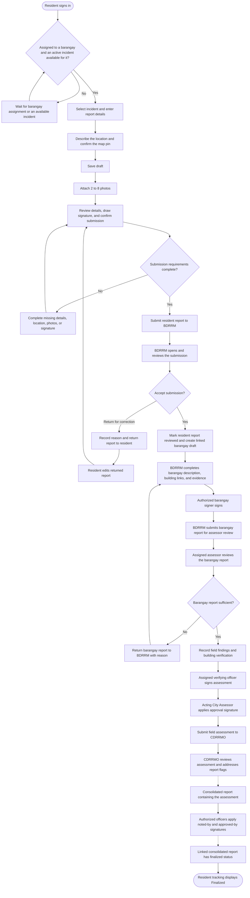

# MapR Resident Report Flow

This document describes how a report moves from a resident to BDRRM, the assessor, and CDRRMO, based on the current application code.

**Main path:** Resident → BDRRM → Assessor → Acting City Assessor → CDRRMO → Finalized consolidated report.

## Flowchart

The diagram uses Mermaid and can be viewed in a Markdown viewer that supports Mermaid.

**Dashed arrows:** These describe the final business handoff. The current code supports consolidated report viewing, signatures, and recognition of an existing `finalized` status, but does not expose a report creation or finalization action in the inspected application routes and services. Applying signatures alone does not automatically finalize a report.

## Responsibilities and handoffs

| Stage | Responsible person or office | Action and result |
| --- | --- | --- |
| 1. Prepare | Resident | Follow the **Details → Photos → Review** wizard. Select an active incident assigned to the resident's barangay, describe what happened and where, and confirm the map location. Observation time may also be supplied. |
| 2. Submit | Resident | Attach at least 2 and at most 8 photos, draw a signature, confirm the declaration, and submit. The resident report becomes `submitted`. |
| 3. Review | BDRRM | Opening a submitted resident report changes it to `under_review`. Review the description, location, and evidence. |
| 4a. Return | BDRRM → Resident | Record a correction reason and set the resident report to `returned`. The resident corrects it and resubmits using the same resident report reference. |
| 4b. Accept | BDRRM | Set the resident report to `reviewed` and create a linked barangay report in `draft`. Acceptance does not yet submit the barangay report to the assessor. |
| 5. Prepare barangay report | BDRRM and authorized barangay signer | Complete the report description, link at least one building, attach the required barangay evidence, resolve open flags before signing, and obtain the authorized barangay signature. |
| 6. Forward | BDRRM → Assessor | Submit the barangay report. Its status becomes `review`; the system starts an assessment for an assigned assessor when a matching active barangay assignment exists. |
| 7. Assess | Assigned assessor | Review the report, record field findings, and verify the building location, household link, and damage classification. Only the assigned assessor may record an estimated repair cost after BDRRM submission. |
| 8. Verify and approve | Assigned verifying officer and Acting City Assessor | The verifying officer signs the assessment, setting it to `signed`. A separate Acting City Assessor approval signature is required before submission. Resolve open assessment flags before signing or forwarding. |
| 9. Submit assessment | Assessor → CDRRMO | Submit the signed and approved field assessment. Its status becomes `submitted`. |
| 10. Review and consolidate | CDRRMO | Review the assessment and the consolidated report that includes it. Authorized officers provide the `noted_by` and `approved_by` signatures. Open consolidated-report flags block these signatures. |
| 11. Track completion | Resident | Once the linked consolidated report has `finalized` status, the resident sees **Finalized** in report tracking. |

## Resident submission requirements

- The resident must be signed in and assigned to a barangay.
- The selected disaster incident must be active and linked to that barangay.
- The incident description and location description must be filled in.
- The location must have confirmed latitude and longitude.
- The report must contain **2–8 photos**. Supported formats are JPEG, PNG, and WebP, with a maximum of **10 MB per photo**.
- The resident must have a saved current signature and confirm the submission declaration.
- The report must be in `draft` or `returned` status to be edited or submitted.

Residents describe observations and supply evidence. Building and household record links, verified damage classifications, and estimated repair costs are handled by authorized staff later in the flow.

## Status labels shown to the resident

The tracking label reflects progress in linked reports; it is separate from the resident report's stored status.

| Resident-facing label | Trigger |
| --- | --- |
| **Draft** | The resident report is saved as `draft`. |
| **Pending BDRRM Review** | The report is submitted, under review, or accepted, and its linked barangay report has not yet been submitted. |
| **Needs Correction** | BDRRM returns the resident submission. The return reason is shown to the resident. |
| **Pending Assessor Review** | The linked barangay report has a submission timestamp, and the linked assessment has not been submitted to CDRRMO. |
| **Pending CDRRMO Review** | The linked field assessment is `submitted`, and the linked consolidated report is not yet `finalized`. |
| **Finalized** | The linked consolidated report is `finalized`. |

The resident can view the report's reference and timeline and preview or download the resident report PDF. Editing is available only for drafts and returned resident submissions; only drafts may be deleted.

## Correction paths

1. **Before submission:** Missing requirements keep the resident in the wizard until the report is complete. A draft can be saved and resumed.
2. **BDRRM → Resident:** BDRRM may return a submitted or under-review resident report before it is linked to a barangay report. The resident sees the reason, edits the report, and resubmits.
3. **Assessor → BDRRM:** The assessor can return a barangay report for correction. For a signed source report, the application creates a successor correction copy that references the original. BDRRM corrects and submits the applicable report version.
4. **Report flags:** Authorized staff can raise and resolve flags on barangay reports, field assessments, and consolidated reports. Open flags block the applicable signing or forwarding operations. This does not itself return the resident submission or make it editable.

## Source references

- [Resident report wizard](../resources/js/resident/pages/ReportWizardPage.vue)
- [Resident report workflow and tracking labels](../app/Services/ResidentReportWorkflow.php)
- [Resident submission controller](../app/Http/Controllers/Resident/ReportController.php)
- [Resident photo requirements](../app/Http/Controllers/Resident/PhotoController.php)
- [BDRRM review and acceptance](../app/Http/Controllers/Bdrrm/BarangayReportController.php)
- [Barangay and assessment workflow](../app/Services/ReportWorkflow.php)
- [Assessor review and correction handling](../app/Http/Controllers/Assessor/AssessmentController.php)
- [CDRRMO report review](../app/Http/Controllers/Cdrrmo/ReportIndexController.php)
- [Consolidated report signatures](../app/Http/Controllers/Cdrrmo/ConsolidatedSignatureController.php)
- [Report flags](../app/Http/Controllers/Shared/ReportFlagController.php)
